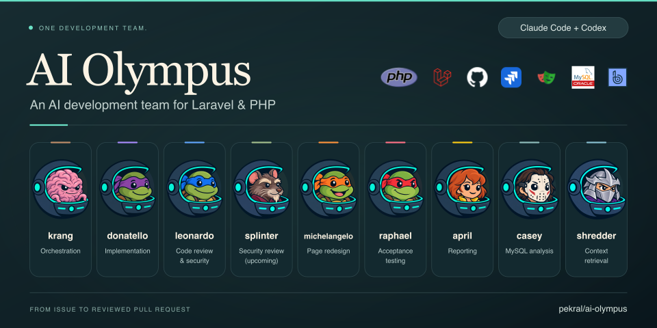

<div align="left">
    

<h1>AI Olympus</h1>

[](https://packagist.org/packages/pekral/ai-olympus)
[](LICENSE)

[](https://packagist.org/packages/pekral/ai-olympus)

</div>

AI Olympus is a Composer plugin that gives PHP and Laravel teams shared coding-standard rules, 67 reusable skills, and nine specialist agents for Claude Code and Codex. Its workflows cover issue implementation, Pest tests, code and security review, acceptance testing, and tracker reporting. The skills, agents, and commands are also published as a Claude Code plugin for projects without Composer, without the rules.

## Requirements

- PHP 8.4 or newer and Composer 2, for the Composer installer
- Claude Code or Codex, to run the workflows; GitHub workflows also need an authenticated `gh` CLI
- Optional: the `pdo_sqlite` extension with FTS5, for the code-review memory; without it the agents continue without memory

CI installs the package into a clean Composer project on PHP 8.4, 8.5, and 8.6 and checks that the Claude Code and Codex files are written. It does not run the agents inside Claude Code or Codex, so agent availability and permissions still depend on your agent host. The Claude Code plugin channel needs no PHP; CI checks its manifests but does not install it into Claude Code.

## Installation

From your Composer project root:

```bash
composer require pekral/ai-olympus:0.4 --dev
vendor/bin/ai-olympus install --force
```

> [!IMPORTANT]
> `install` normally copies only missing files; security rule files are refreshed even without `--force`. `--force` also replaces the other installed rules, skills, and agents, so save local customizations first. Neither root instruction file (`CLAUDE.md`, `AGENTS.md`) is overwritten.
>
> During the agent rename, the installer removes verified, unchanged copies of the old definitions once their replacements are installed. Edited old definitions and custom agents are preserved. See the [old-to-new name mapping](docs/agents.md#renamed-agents). Use `--prune` only after reviewing orphaned files: it also removes custom files absent from the package.

The constraint pins release `0.4`; commit your project's `composer.lock` to keep installations reproducible. Composer may ask whether you trust the package as a plugin; see the [plugin trust model](SECURITY.md#plugin-trust-model).

The installer writes, for Claude Code and Codex:

- `.claude/rules` and `.codex/rules` — the rule library
- `.claude/skills` and `.agents/skills` — the skills, in the project only
- `.claude/agents`, `.codex/agents`, and `.codex/agent-instructions` — the nine agents and their Codex adapters
- `.claude/commands` — the four slash commands
- `AGENTS.md` in the project root, unless one already exists

`--global` additionally writes the skills to `~/.claude/skills` and `~/.agents/skills`. Every other switch, the installer flow, and the distribution contents are in [`docs/installation.md`](docs/installation.md).

### Claude Code plugin marketplace (no Composer)

```text
/plugin marketplace add pekral/ai-olympus
/plugin install ai-olympus@ai-olympus
```

This loads all 67 skills, the nine agents, and the four commands into Claude Code only. It does **not** load the rules: Claude Code reads neither `rules/` nor a `CLAUDE.md` out of a plugin directory. The opt-in security switches stay bound to the Composer installer, and a plugin install writes nothing to `.claude/settings.local.json`. See [which path to choose](docs/installation.md#which-path-to-choose).

## Configuration

Nothing has to be configured before the first run; restart the agent session after installation.

The installer never generates a `CLAUDE.md`, and it keeps an existing `CLAUDE.md` and `AGENTS.md`. Without a `CLAUDE.md`, Claude Code 2.1.277+ uses `AGENTS.md` as its project instructions (except on Bedrock, Vertex, and Foundry). If your project already had an `AGENTS.md`, merge the [Codex integration section](AGENTS.md#codex-integration) into it.

Automatic installation on `composer install` and `composer update` is off by default; [`extra.ai-olympus.auto-install`](docs/installation.md#automatic-installation-via-composer-plugin) turns it on, and then every install and update runs `install --force`. The same `extra.ai-olympus` object is the [project manifest](docs/installation.md#project-manifest), which tells the workflows how your project runs its quality gate and coverage; every key is optional, and an absent key keeps the built-in behaviour. Your own `CLAUDE.md`, `AGENTS.md`, `.ai/rules/**`, and the manifest take precedence over the packaged rules; only the security floor stays fixed.

Installation leaves global Claude settings unchanged by default. The opt-in switches, such as `--disable-co-author-attribution`, `--allow-subagent-writes`, and `--deny-network-bash`, configure Claude Code only and grant Codex no permissions; see the [trust model](SECURITY.md).

## Quick start

In Claude Code, start the session as `krang`, so the session itself orchestrates and dispatches the specialists:

```text
claude --agent krang "resolve https://github.com/owner/repo/issues/123"
```

A command works in any session, because the session that receives it holds the `krang` role itself:

```text
/prepare-issue-for-merge https://github.com/owner/repo/issues/123
```

In Codex, ask the root session to take the `krang` role, so it spawns the specialists itself:

```text
Follow .codex/agent-instructions/krang.md as krang and resolve https://github.com/owner/repo/issues/123
```

[`rules/compound-engineering/orchestration.md`](rules/compound-engineering/orchestration.md) *Starting the orchestrator — the top-level role and the nested hand-over* explains why `krang` is not started as a subagent.

`krang` routes implementation to `donatello`, each code review round to `leonardo`, `splinter` (an independent security view), `raphael` (interactive testing, when the change is user-visible), and `casey` (an advisory database report) in parallel, a page redesign to `michelangelo` before anything is built, context retrieval to `shredder` when the relevance gate asks for it, and the final report to `april`. Merging stays a separate, explicit step.

## What it does

| Layer | What it is | Installed into |
|---|---|---|
| Rules | Project standards for PHP, Laravel, security, SQL, APIs, tests, git, and code review | `.claude/rules`, `.codex/rules` |
| Skills | Reusable workflows, from `resolve-issue` to `security-review` | `.claude/skills`, `.agents/skills` |
| Agents | Shared role definitions with Codex TOML adapters | `.claude/agents`, `.codex/agents`, `.codex/agent-instructions` |
| Commands | `/prepare-issue-for-merge`, `/redesign-page`, `/report-code-review`, `/test-assignment` | `.claude/commands` |

The Markdown files in `.codex/rules` are an instruction library, **not native Codex command-approval rules**: the root `AGENTS.md` tells Codex which of them to read. Codex has no user-defined slash commands, so it reaches each command's workflow through the skill the command delegates to, such as `$verify-merge-readiness`, `$deliver-page-redesign`, or `$test-assignment`.

The workflows require tests for the changed behaviour and zero Critical and no undeferred Moderate review findings before merge. When your project installs `laravel/pao`, the rules read its compact JSON output of Pest, PHPUnit, Paratest, PHPStan, Rector, and Artisan, and trust only the process exit code.

### Agents

The roster is named after Teenage Mutant Ninja Turtles characters. Each agent starts on its default model tier and escalates only on a recorded reason; the values come from `agents/*.md` and `codex/agents/*.toml`.

| | Agent | Role | Claude Code | Codex |
|---|---|---|---|---|
|  | `krang` | orchestrator, the front door | `opus` · high | `gpt-6.1-sol` · high |
|  | `donatello` | implementer, opens a draft PR | `sonnet` · high | `gpt-5.6-terra` · high |
|  | `leonardo` | code and security reviewer, read-only | `opus` · high | `gpt-6.1-sol` · high |
|  | `splinter` | independent security reviewer, read-only | `opus` · high | `gpt-6.1-sol` · high |
|  | `raphael` | acceptance tester on a local instance, read-only | `sonnet` · medium | `gpt-6-luna` · medium |
|  | `michelangelo` | page redesign proposal | `opus` · high | `gpt-6-astra` · high |
|  | `casey` | advisory database report, read-only | `sonnet` · high | `gpt-6-luna` · high |
|  | `shredder` | context retrieval, read-only | `opus` · high | `gpt-6.1-sol` · high |
|  | `april` | final tracker report and announcements | `haiku` · medium (not applied to Haiku) | `gpt-6-luna` · medium |

Role boundaries, the handoff contract, and the avatar assets are in [`docs/agents.md`](docs/agents.md). Running a single specialist, the four command workflows, and how agents hand work over are in [`docs/workflows.md`](docs/workflows.md).

### Adaptive routing — how much pipeline a task gets

Every `krang` run classifies the task with `skills/_shared/classify-risk.sh`, a deterministic shell script, and picks a `FAST`, `STANDARD`, or `CRITICAL` pipeline. A sensitive area such as authentication, secrets, payments, or migrations forces `CRITICAL`, while tests, static analysis, CI, and the pre-merge quality gate run at every tier. The tiers are roles rather than model names, so Codex / OpenAI sessions route identically. Ask for thorough mode (`--thorough`) to run the complete pipeline regardless of the classification. See [Adaptive routing](docs/workflows.md#adaptive-routing--how-much-pipeline-a-task-gets) for the tier table and overrides.

### Code-review memory

Resolved Critical code-review findings are kept in a per-user, git-ignored SQLite database (`.claude/run/code-review-memory.sqlite`, or `.codex/run/` under Codex), which `krang` reads only when a review opens a Critical finding. `krang` is the only writer: it adds one short TL;DR entry after a human approved it. The installer never creates or deletes it.

```bash
vendor/bin/ai-olympus memory migrate
```

`memory migrate` moves the entries of `docs/memory/PROJECT_MEMORY.md` into the database once. Exit `0` is a result (possibly empty), `1` a usage error, `2` an unavailable memory. The `memory add` and `memory query` subcommands, `stats` for routing metrics, and `graph` for the repository graph are described in [`docs/workflows.md`](docs/workflows.md).

## Documentation

- [`docs/installation.md`](docs/installation.md) — installer flow, every CLI switch, auto-install, the project manifest, and where skills are installed
- [`docs/agents.md`](docs/agents.md) — the agent roster, capability model, handoff contract, and troubleshooting
- [`docs/workflows.md`](docs/workflows.md) — command workflows, adaptive routing, metrics, the repository graph, and the code-review memory
- [`docs/skills.md`](docs/skills.md) — the catalog of all 67 skills
- [`docs/rules.md`](docs/rules.md) — the 33 rule files, grouped by scope

## Testing

From a checkout of this repository, install the development dependencies with `composer install`, then:

```bash
vendor/bin/pest tests        # run the test suite
composer test:coverage       # require 100% coverage (PCOV)
composer analyse             # PHPStan
composer security-audit      # dependency audit
```

`composer build` is the full pre-merge gate: it runs the installer with `--force --prune`, the automatic fixers, then every check. It changes files, so use it at the merge boundary, not as a read-only check. Its skill linter also needs Node.js and npm.

## Upgrading

Review the [changelog](CHANGELOG.md) before changing the version constraint, save local customizations, and refresh the installed files with `--force --prune` after the update. During `0.x`, a new minor version may change workflow behaviour or installer options. A project upgraded from a release that always installed skills globally clears the old home copies once with `vendor/bin/ai-olympus install --prune-global`, which deletes them by name, immediately and without a backup. See [versions and upgrades](docs/installation.md#versions-and-upgrades) and [where skills are installed](docs/installation.md#where-skills-are-installed).

## Changelog

See [CHANGELOG](CHANGELOG.md).

## Contributing

See [CONTRIBUTING](CONTRIBUTING.md) for the quality gate, how to add or change a skill, and the commit and pull request conventions. This project follows the [Contributor Covenant Code of Conduct](CODE_OF_CONDUCT.md). Ask questions in the [Discussions Q&A](https://github.com/pekral/ai-olympus/discussions/categories/q-a) and keep the issue tracker for bugs and feature requests.

## Security

See [the security policy](SECURITY.md) for the plugin trust model, the installer security switches, and how to report a vulnerability privately.

## Credits

Created by [Petr Král](https://pekral.cz).

## License

The package code is licensed under the MIT License; see [`LICENSE`](LICENSE). The banner artwork is distributed under CC BY-SA 4.0; artwork sources, licences, and trademarks are listed in [`assets/ATTRIBUTION.md`](assets/ATTRIBUTION.md).
