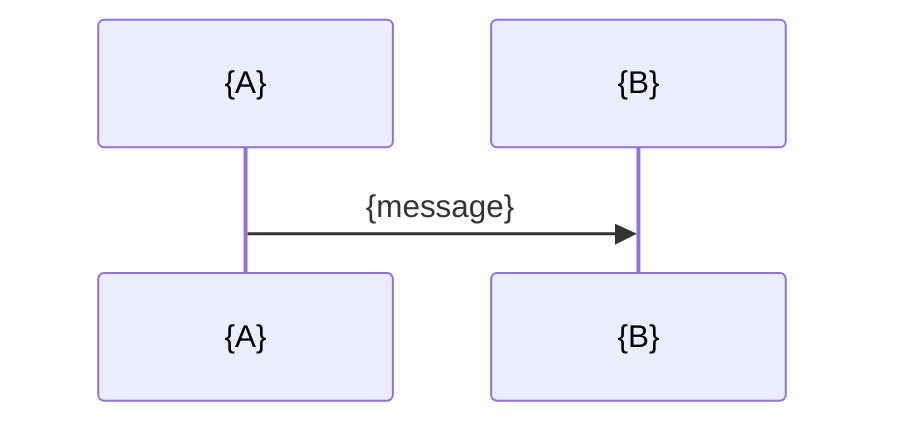

# Review body (the visible part)

> The visible part of the one pull-request review on GitHub. `skills/code-review-github/scripts/post-inline-review.sh post` renders it above the hidden record (`templates/pr-comment-output.md`) from three inputs: the walkthrough file, the `Merge risk:` line of the record, and the findings file. This file fixes the blocks, their order, and the text each one carries. Canonical contract: `@skills/code-review-github/references/cr-wrapper-contract.md` *GitHub pull-request review*, and `@rules/code-review/general.md` *One published comment per review run*.
>
> **Five blocks, in this order, and nothing else but the one line below.** A summary paragraph, a collapsed **Merge Risk**, a collapsed **Walkthrough**, a collapsed **Where to test**, and a collapsed **Actionable comments** block. One more collapsed block, **Known points**, comes after **Actionable comments** and renders only when a linked issue reports a finding (*Known points* below). The summary opens the body with no label and no heading before it. The review shows no pre-merge checks, no recent review information, no CI result, no button, no badge or image, and no share link. **Where to test** renders only when the change touches a page or a route, and **Actionable comments** renders only when at least one finding is published. Every `<details>` block is closed in the template.
>
> One line stands between the summary and **Merge Risk**, only when the record carries it: `**Review independence:** not independent — helper agents are forbidden for this project`. It is the line of a review that the session which wrote the change ran itself (`skills/_shared/orchestration/helper-agents.md` *Report lines*). The wrapper copies it from the record and refuses a record that carries any other value of that line.
>
> **Code in the body: the suggested code of a finding only.** The problem and the fix are plain sentences, and no other value of the body holds a fenced block, a suggestion block, or a replacement snippet. Two fences are allowed: the mermaid sequence diagram of the Walkthrough, and the suggested code of an Actionable comments entry, which the findings file sets in `suggestion`. The wrapper refuses a finding or a walkthrough that holds any other fence (`@rules/code-review/general.md` *A review carries no code*).
>
> **Where each value comes from.**
> - **The summary, the description, the changed areas, the effort, the change type, the diagram, and the routes** come from the review run, which derives them from the diff, the assignment, and the changed files. It writes them as one JSON object in the walkthrough file, so the wrapper renders them the same way on every run (the keys are in the header of `post-inline-review.sh`). The wrapper checks that every file of a changed area is a changed file of the pull request.
> - **The routes of Where to test** come from the route inventory of `@skills/security-review/SKILL.md` *Route Access of Changed Routes*, which the review already builds statically from the diff. The review reuses it, builds no second inventory, and reads no running application. Each row is an HTTP method, a path a reviewer can open, and one short line on what to try there.
> - **The Merge Risk grade and its sentence** come from the `Merge risk:` line of the hidden record, the one owner of both (`@rules/code-review/general.md` *Merge risk*). The block adds the colour (🟢 low, 🟡 medium, 🔴 high) and the short SHA of the reviewed head.
> - **The Actionable comments** come from the findings file: one entry for every published finding, on a changed line or not, Critical first. The review carries no inline comment, so this block is the one place a person reads a finding. A security finding marked `do not file publicly` on a public repository is in no block (the check of `@skills/code-review-github/references/cr-wrapper-contract.md` *Findings in the review body*).
>
> **A later review shows only the changes since the previous published review.** When the pull request already carries a trusted code-review report (`@rules/code-review/general.md` *Baseline resolution*, source 2) and its `Reviewed revision:` is an earlier commit of the reviewed head (`git merge-base --is-ancestor`), the summary, the Walkthrough, and Where to test describe only `git diff <that revision>..<reviewed head>`. The walkthrough file sets `since` to that revision, so the wrapper checks every area against the files of that range and shows `since <short SHA>` in the Walkthrough summary. The summary never repeats what the previous review already described.
> Two blocks still cover the whole pull request: **Merge Risk** grades the merge, and **Actionable comments** lists every open finding, new and carried over, because the newest review is the evidence the merge gate reads. The hidden record keeps its own rules (`@skills/code-review-github/references/cr-wrapper-contract.md` *GitHub pull-request review*).
> The first review, and a review whose previous revision is no earlier commit of the head after a history rewrite, describe the whole pull request and leave `since` out.
>
> **The summary holds at most 500 characters.** The wrapper counts code points of the normalised text (control characters removed, the text trimmed, and encoded as *Every value renders as text* states) and refuses a longer text with exit `1` and nothing posted. It never cuts a text. The author rewrites the summary shorter and publishes again. The summary is plain sentences: no line of it starts with `#`, `>`, `|`, or `<` once the control characters are removed.
>
> **Every value renders as text.** The wrapper encodes each value from the walkthrough, the record, and the findings once, before it renders it: `&`, `<`, `>`, `|`, and `\` become HTML entities, `![` loses its image markup, a backtick that closes no code span on its line becomes an entity, and a line loses its indent, a leading `#`, and a run of `-`, `=`, `*`, or `_`.
> A closed code span on one line becomes a `<code>` element whose content encodes every character Markdown or a GitHub autolink reads as syntax as an entity, so the rendered review shows `$this->authorize()` and `Collection<int, Order>` as written. The output holds no literal backtick, so GitHub never pairs a code span differently, for example after a backtick inside a link target. No value renders as HTML, an image, a table cell break, a heading, or a code block. The mermaid diagram and the suggested code of a finding are the values rendered as written, each inside its own fence.
>
> **Name no tooling of this package.** Every visible text follows `@rules/code-review/general.md` *Visible review text names none of the package's own tooling*. The wrapper checks the summary, the Merge Risk sentence, the Walkthrough, Where to test, and the Actionable comments.

````markdown
{what the pull request changes, or on a later review what changed since the previous published review, in plain sentences; at most 500 characters; no label, no heading, no code}

{only when the record carries it: **Review independence:** not independent — helper agents are forbidden for this project}

<details>
<summary><strong>Merge Risk:</strong> <strong>{🟢 Low | 🟡 Medium | 🔴 High}</strong> · up to <code>{short SHA}</code></summary>
<dl>
<dd>
<br>

{the one sentence of the `Merge risk:` line of the record}

</dd>
</dl>
</details>

<details>
<summary><strong>Walkthrough</strong>{ · since <code>{short SHA of the previous review}</code>, only on a later review}</summary>
<dl>
<dd>
<br>

{the change in one to three plain sentences}

**Changes: {title}**

|Layer / File(s)|Summary|
|:---|:---|
|**{area}** <br> `{file}`, `{file}`|{one-line summary of the change in that area}|

**Estimated code review effort:** {1-5} ({Trivial | Simple | Moderate | Complex | Critical}) | ~{minutes} minutes
**Change:** {Feature | Bug fix | Refactor | Performance | Security | Tests | Documentation | Chore}

### Sequence Diagram(s)



</dd>
</dl>
</details>

<details>
<summary><strong>Where to test</strong></summary>
<dl>
<dd>
<br>

| Method and path | What to try |
| :--- | :--- |
| `{METHOD} {/path}` | {one short line on what to try there} |

</dd>
</dl>
</details>

<details>
<summary><strong>Actionable comments ({n})</strong></summary>
<dl>
<dd>
<br>

**🔴 Critical 1 — {title}** · `{file:line}`
{the problem, in one sentence}
**Fix:** {what to change, in one sentence}
**Suggested code** (replaces lines {start}–{end}):
```{language of the file}
{the corrected code of those lines, as written}
```
@{login}

**🟠 Moderate 1 — {title}** · `{file:line}`
{the problem, in one sentence}
**Fix:** {what to change, in one sentence}

</dd>
</dl>
</details>
````

- **`**Changes: {title}**` renders only when the walkthrough sets a `title`.** The table has one row for each changed area, and a row names at most four files and then `and {n} more`.
- **The Walkthrough lists no test file.** A row names production files only, and the table has no row for the tests. A pull request that changes only tests is the one exception. The wrapper refuses a row that names a test file, with exit `1` and nothing posted; the header of `post-inline-review.sh` states which paths count as test files.
- **The Where to test table has one row for each route, and `{METHOD}` is GET, POST, PUT, PATCH, or DELETE.** The whole block is left out when the change touches no page or route.
- **The sequence diagram renders only when the change has a flow worth drawing.** The walkthrough sets `diagram` for it and leaves it out otherwise, and the heading and the fence go with it.
- **A finding with no line has no `· {file:line}` place.** A functional gap is one.
- **An entry ends with the `@login` mention line only when the finding sets `author`** (a missing-test or DRY finding of a review-only run), on a changed line or not.
- **A DRY finding's `Fix:` names the existing implementation** when the finding sets no `fix` of its own. A DRY / reuse finding is Moderate (`@rules/code-review/general.md` *Reuse Existing Logic*); a duplicated security control keeps its security severity.
- **`**Suggested code**` and its fence render only when the finding sets `suggestion`.** The code is the corrected code of the finding's lines and renders as written. The note says `(replaces line {n})` for one line and is left out for a removed line or a finding with no line. The fence carries the language of the file, from its extension, and is one backtick longer than the longest backtick run of the code, three at least, so code that holds a fence never closes it. A finding with no code fix carries the `Fix:` sentence alone. When the code of every entry does not fit the body limit, the code of the last entries is left out and their `Fix:` sentences stay.
- **The entries are numbered for each severity**, in the order of the findings file.
- **`Known points ({n})` renders only when the walkthrough sets `known_points`.** The block follows **Actionable comments**, with the same `<details>` markup, and it lists one line for each known point: `- **{title}** · `{place}` — [{#N or KEY}]({URL of the linked issue}): {one sentence on what the issue covers and why it is the same problem}`. The place is left out when the row has none. A known point is no finding: it is in no Actionable comments entry, in no count, and in no verdict (`@rules/code-review/review-process.md` *Known points — a finding that a linked issue already reports (issue #682)*). The wrapper accepts a GitHub issue URL or a JIRA `/browse/` URL, and nothing else.
- **A security known point is the row `{issue, security: true, owner}`.** It renders as `- **Security point** — [#N]({URL}): the linked issue already tracks it, and `{owner}` owns it there.`, with no title, no place, and no sentence of its own, because it merges unfixed (`@rules/code-review/review-process.md` *Known points*). The wrapper writes that sentence and accepts only a GitHub issue URL and a GitHub login on such a row.
