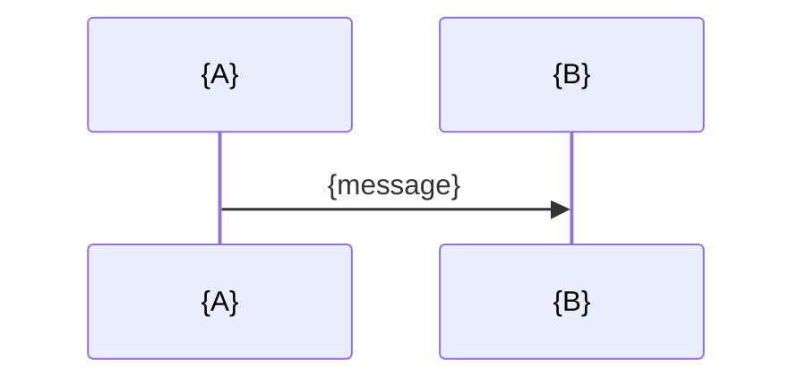

# Review body (the visible part)

> The visible part of the one pull-request review on GitHub. `skills/code-review-github/scripts/post-inline-review.sh post` renders it above the hidden record (`templates/pr-comment-output.md`) from three inputs: the walkthrough file, the `Merge risk:` line of the record, and the findings file. This file fixes the blocks, their order, and the text each one carries. Canonical contract: `@skills/code-review-github/references/cr-wrapper-contract.md` *GitHub pull-request review*, and `@rules/code-review/general.md` *One published comment per review run*.
>
> **Five blocks, in this order, and nothing else.** A summary paragraph, a collapsed **Merge Risk**, a collapsed **Walkthrough**, a collapsed **Where to test**, and a collapsed **Actionable comments** block. The summary opens the body with no label and no heading before it. The review shows no pre-merge checks, no recent review information, no CI result, no button, no badge or image, and no share link. **Where to test** renders only when the change touches a page or a route, and **Actionable comments** renders only when at least one finding is published. Every `<details>` block is closed in the template.
>
> **A review carries no code.** No block of the visible body holds a fenced block, a suggestion block, or a replacement snippet. The problem and the fix are plain sentences. The one fence the body allows is the mermaid sequence diagram of the Walkthrough. The wrapper refuses a finding or a walkthrough that holds any other fence (`@rules/code-review/general.md` *A review carries no code*).
>
> **Where each value comes from.**
> - **The summary, the description, the changed areas, the effort, the change type, the diagram, and the routes** come from the review run, which derives them from the diff, the assignment, and the changed files. It writes them as one JSON object in the walkthrough file, so the wrapper renders them the same way on every run (the keys are in the header of `post-inline-review.sh`). The wrapper checks that every file of a changed area is a changed file of the pull request.
> - **The routes of Where to test** come from the route inventory of `@skills/security-review/SKILL.md` *Route Access of Changed Routes*, which the review already builds statically from the diff. The review reuses it, builds no second inventory, and reads no running application. Each row is an HTTP method, a path a reviewer can open, and one short line on what to try there.
> - **The Merge Risk grade and its sentence** come from the `Merge risk:` line of the hidden record, the one owner of both (`@rules/code-review/general.md` *Merge risk*). The block adds the colour (🟢 low, 🟡 medium, 🔴 high) and the short SHA of the reviewed head.
> - **The Actionable comments** come from the findings file: one entry for every published finding, Critical first. A finding that anchors to a changed line also has its inline comment (`templates/inline-review-comment.md`). A security finding marked `do not file publicly` on a public repository is in no block (the check of `@skills/code-review-github/references/cr-wrapper-contract.md` *Inline review comments*).
>
> **The summary holds at most 4,000 characters.** The wrapper counts code points of the normalised text (control characters removed, the text trimmed, and encoded as *Every value renders as text* states) and refuses a longer text with exit `1` and nothing posted. It never cuts a text. The author rewrites the summary shorter and publishes again. The summary is plain sentences: no line of it starts with `#`, `>`, `|`, or `<` once the control characters are removed.
>
> **Every value renders as text.** The wrapper encodes each value from the walkthrough, the record, and the findings once, before it renders it: `&`, `<`, `>`, `|`, and `\` become HTML entities, `![` loses its image markup, a backtick that closes no code span on its line becomes an entity, and a line loses its indent, a leading `#`, and a run of `-`, `=`, `*`, or `_`. A closed code span on one line shows its content as written, because a code span renders no markup: `$this->authorize()` and `Collection<int, Order>` read as they are. Only `<!` stays encoded there, and a pipe in a table cell becomes `\|`. No value renders as HTML, an image, a table cell break, a heading, or a code block. The mermaid diagram is the one value rendered as written, inside its fence.
>
> **Name no tooling of this package.** Every visible text follows `@rules/code-review/general.md` *Visible review text names none of the package's own tooling*. The wrapper checks the summary, the Merge Risk sentence, the Walkthrough, Where to test, the Actionable comments, and every inline comment.

````markdown
{what the pull request changes, in plain sentences; at most 4,000 characters; no label, no heading, no code}

<details>
<summary><strong>Merge Risk:</strong> <strong>{🟢 Low | 🟡 Medium | 🔴 High}</strong> · up to <code>{short SHA}</code></summary>
<dl>
<dd>
<br>

{the one sentence of the `Merge risk:` line of the record}

</dd>
</dl>
</details>

<details>
<summary><strong>Walkthrough</strong></summary>
<dl>
<dd>
<br>

{the change in one to three plain sentences}

**Changes: {title}**

|Layer / File(s)|Summary|
|:---|:---|
|**{area}** <br> `{file}`, `{file}`|{one-line summary of the change in that area}|

**Estimated code review effort:** {1-5} ({Trivial | Simple | Moderate | Complex | Critical}) | ~{minutes} minutes
**Change:** {Feature | Bug fix | Refactor | Performance | Security | Tests | Documentation | Chore}

### Sequence Diagram(s)



</dd>
</dl>
</details>

<details>
<summary><strong>Where to test</strong></summary>
<dl>
<dd>
<br>

| Method and path | What to try |
| :--- | :--- |
| `{METHOD} {/path}` | {one short line on what to try there} |

</dd>
</dl>
</details>

<details>
<summary><strong>Actionable comments ({n})</strong></summary>
<dl>
<dd>
<br>

**🔴 Critical 1 — {title}** · `{file:line}`
{the problem, in one sentence}
**Fix:** {what to change, in one sentence}

**🟠 Moderate 1 — {title}** · `{file:line}`
{the problem, in one sentence}
**Fix:** {what to change, in one sentence}

</dd>
</dl>
</details>
````

- **`**Changes: {title}**` renders only when the walkthrough sets a `title`.** The table has one row for each changed area, and a row names at most four files and then `and {n} more`.
- **The Where to test table has one row for each route, and `{METHOD}` is GET, POST, PUT, PATCH, or DELETE.** The whole block is left out when the change touches no page or route.
- **The sequence diagram renders only when the change has a flow worth drawing.** The walkthrough sets `diagram` for it and leaves it out otherwise, and the heading and the fence go with it.
- **A finding with no line has no `· {file:line}` place.** A functional gap is one.
- **An entry ends with the `@login` mention line when the finding sets `author` and has no inline comment** (a missing-test or DRY finding of a review-only run outside the diff). A finding with an inline comment carries the mention there only.
- **A DRY finding's `Fix:` names the existing implementation** when the finding sets no `fix` of its own.
- **The entries are numbered for each severity**, in the order of the findings file.
