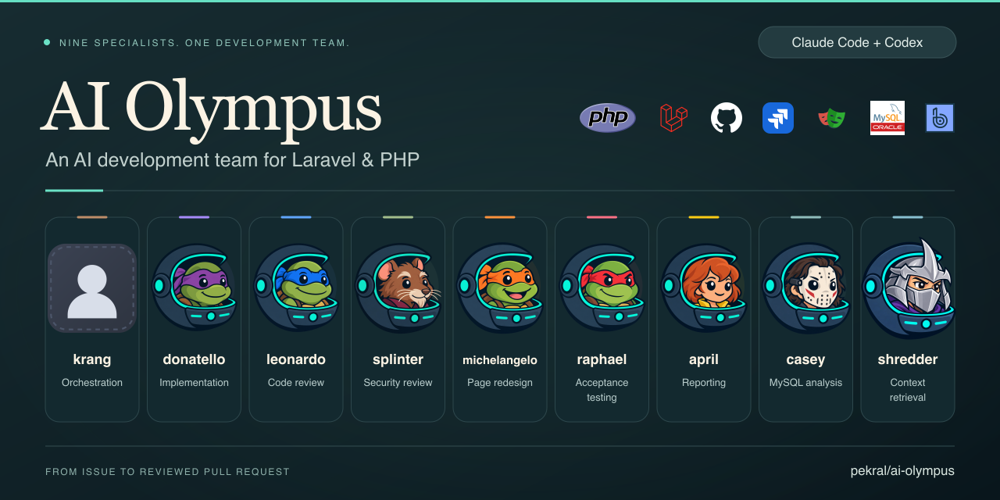

# X brand writing usage

## Table of contents

- [Install and invoke](#install-and-invoke)
- [Prompt patterns](#prompt-patterns)
- [Output rules](#output-rules)
- [Sample validation](#sample-validation)
- [Executed preference-isolation validation](#executed-preference-isolation-validation)
- [Preference record](#preference-record)

## Install and invoke

Install this folder with the rest of the package. In a host project, the installer places it in both skill locations:

- Claude Code: `.claude/skills/x-brand-writing/`. Invoke `/x-brand-writing`.
- Codex: `.agents/skills/x-brand-writing/`. Invoke `$x-brand-writing`.

On a host that has AI Olympus installed, the skill loads the host's `agent-voice` skill before drafting. A portable standalone copy still drafts with the fallback in `SKILL.md`; it needs no dependency or script.

## Prompt patterns

```text
/x-brand-writing
Draft an English launch post for this project from README.md and CHANGELOG.md.
Audience: Laravel maintainers. Goal: explain the new capability without hype.
```

```text
$x-brand-writing
Write a Czech educational thread from docs/skills.md about how a project skill stays portable.
Use only verified repository facts and recommend an existing repository image.
```

```text
$x-brand-writing
Keep this edit as a style preference for this project: lead with a concrete use case,
avoid exclamation marks, and end without a question. Save it in this host only.
```

```text
$x-brand-writing
Forget the preference about ending without a question for this project. Do not publish anything.
```

```text
$x-brand-writing
Host: the fictional project "Signal Kite". Use only these facts: it helps volunteer
coordinators share shift changes, and its latest update adds a printable weekly view.
Draft an English launch post. Recommend no asset unless Signal Kite provides one.
```

## Output rules

Return exactly two variants. Each recommendation points to an existing, verified, shareable host-project path or URL and sits outside the copy-ready text. The same asset may support both variants. When the host UI supports Markdown or a native preview, show one shared preview outside the copy-ready text; never invent an attachment. A missing suitable asset is stated plainly outside the drafts.

Use a weighted-length validator when one is available in the host. Otherwise keep each post conservatively short, around 120 non-URL characters or fewer with no more than one URL, and say that weighted validation was not verified. Do not treat an ordinary character count as a weighted result.

## Sample validation

The samples below are drafts only. They do not publish to X. This repository has no suitable installed weighted-length validator, so each uses the conservative fallback and its exact weighted length is not verified.

### Product launch brief

Brief: The host is the fictional project **Signal Kite**. Use only these facts: it helps volunteer coordinators share shift changes, and its latest update adds a printable weekly view. Draft an English launch post. No suitable Signal Kite asset was supplied.

Variant A

Suggested asset: no suitable verified Signal Kite asset found.

Weighted count: not verified — no suitable validator was available.

```text
Volunteer coordinators using Signal Kite can now print a weekly view of shift changes.
```

Variant B

Suggested asset: no suitable verified Signal Kite asset found.

Weighted count: not verified — no suitable validator was available.

```text
Signal Kite’s latest update adds a printable weekly view for sharing shift changes.
```

### Educational brief

Brief: Explain in Czech why short product copy should start with verified project evidence.

Both variants are complete two-post threads.

Variant A

Suggested asset: `assets/social-preview.png`

Preview when the host UI supports it (shared by both variants): 

Weighted count: not verified — no suitable validator was available.

```text
Krátký příspěvek potřebuje ověřená fakta.
```

```text
Nejdřív README, změny a skutečný diff. Potom věta, která čtenáře zaujme.
```

Variant B

Suggested asset: `assets/social-preview.png`

Weighted count: not verified — no suitable validator was available.

```text
Marketing nemusí domýšlet úspěchy projektu.
```

```text
Když vychází z reálných změn a omezení, je stručný a důvěryhodný.
```

### Progress update brief

Brief: Share a Czech progress update about the new writing workflow without claiming that it is published or generally available.

Variant A

Suggested asset: `assets/social-preview.png`

Preview when the host UI supports it (shared by both variants): 

Weighted count: not verified — no suitable validator was available.

```text
Pracujeme na x-brand-writing v AI Olympus.

Dvě varianty, ověřené podklady a grafika. Publikuje člověk.
```

Variant B

Suggested asset: `assets/social-preview.png`

Weighted count: not verified — no suitable validator was available.

```text
Posun v psaní pro X: návrh vychází z toho, co projekt obsahuje.

Workflow odděluje fakta, styl projektu a copy.
```

## Executed preference-isolation validation

This validation used an isolated temporary fixture for the fictional host **Harbor Relay**, then removed that fixture. Its fixture brief supplied only these facts: Harbor Relay helps workshop coordinators share tool-loan handoffs, and its latest update adds a printable daily board. It did not read or write a real project's preferences or personal data.

Two separate implicit edits consistently changed openings to name volunteer coordinators and removed exclamation marks, so the saved host record became:

```md
# X writing preferences

- Confirmed: Open with the named audience or concrete use case. Avoid exclamation marks.
- Tentative: Prefer a practical closing over a question.
- Scope: English launch posts for workshop coordinators.
```

The single ambiguous practical-closing edit remained tentative. The factual correction “the update adds a printable daily board” was excluded from the style record. A new invocation read the saved record without a consent dialog and produced these two drafts:

```text
Workshop coordinators can now use Harbor Relay’s printable daily board for tool-loan handoffs.
```

```text
For workshop coordinators, Harbor Relay now adds a printable daily board for tool-loan handoffs.
```

Both drafts follow the confirmed audience-first opening and contain no exclamation mark. A separate fictional host had no `.x-brand-writing/style.md` record and did not inherit either preference.

## Preference record

After a user edit or explicit feedback, create or update `<host-project-root>/.x-brand-writing/style.md`. Keep it compact:

```md
# X writing preferences

- Confirmed: Lead with a concrete use case. Avoid exclamation marks.
- Tentative: Prefer a practical closing over a question.
- Scope: Czech posts for maintainers.
- Evidence: README.md, CHANGELOG.md
```

Do not store full drafts, secrets, customer data, or preferences for another project. The current brief overrides this record.
