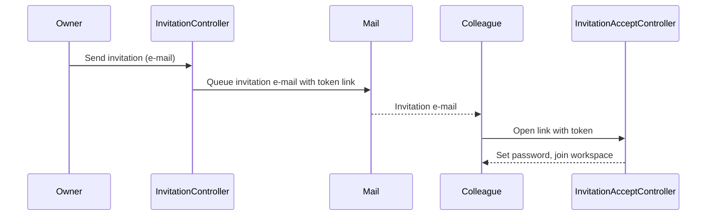

A workspace owner can now invite a colleague by e-mail from the workspace settings or the API. The colleague opens a one-time link, sets a password and joins as a member; the owner sees open invitations and can cancel them. Two Critical findings block the merge: a link works more than once, and an expired link still lets the colleague in.

<strong>Merge Risk:</strong> <strong>🟡 Medium</strong> · up to <code>7c1d2aa</code>

<dl>
<dd>
 

A new sign-in path over workspace membership. Two Critical findings block the merge: an invitation link works more than once, and an expired link still adds a member. The change is easy to revert (no data rewrite).

</dd>
</dl>

<strong>Walkthrough</strong>

<dl>
<dd>
 

The change lets a workspace owner invite a colleague by e-mail. The colleague accepts through a one-time link and joins as a member. Invitations are stored with a token and an expiry, the owner can list and cancel open invitations, and both the web settings and the API can send them.

**Changes: Workspace invitations**

|Layer / File(s)|Summary|
|:---|:---|
|**Send, list and cancel invitations**   <code>app/Http/Controllers/Workspace/InvitationController.php</code>, <code>app/Http/Controllers/Api/InvitationController.php</code>, <code>app/Mail/WorkspaceInvitation.php</code>|The owner sends an invitation from the settings or the API; the e-mail carries the link. Open invitations are listed and can be cancelled.|
|**Store invitations**   <code>app/Models/Invitation.php</code>, <code>database/migrations/2026&#95;11&#95;17&#95;000000&#95;create&#95;invitations&#95;table.php</code>|A new invitation record holds the e-mail, the token, the expiry and the acceptance time.|
|**Accept an invitation**   <code>app/Http/Controllers/InvitationAcceptController.php</code>, <code>routes/web.php</code>|The link signs the colleague up and adds them to the workspace as a member.|

**Estimated code review effort:** 3 (Moderate) | ~25 minutes
**Change:** Feature

### Sequence Diagram(s)

</dd>
</dl>

<strong>Where to test</strong>

<dl>
<dd>
 

| Method and path | What to try |
| :--- | :--- |
| <code>GET /settings/workspace/invitations</code> | Send an invitation to a new e-mail, see it in the open list, cancel it. |
| <code>POST /api/workspace/invitations</code> | Send the 21st invitation of the day and check it is refused. |
| <code>GET /invitations/{token}</code> | Open the link, set a password, join; open the same link again and an 8-day-old link — both must show "This invitation is no longer valid". |

</dd>
</dl>

<strong>Actionable comments (3)</strong>

<dl>
<dd>
 

**🔴 Critical 1 — An invitation link can be used more than once** · <code>app/Http/Controllers/InvitationAcceptController.php&#58;22</code>
The controller finds the invitation by token and never marks it accepted, so a forwarded link adds another member.
**Fix:** accept only an invitation that is not accepted yet, and mark it accepted in the same step.

**🔴 Critical 2 — An expired invitation still lets the colleague in** · <code>app/Http/Controllers/InvitationAcceptController.php&#58;22</code>
<code>expires&#95;at</code> is written but never read, so a link older than 7 days still adds a member (issue #593, *The rules*).
**Fix:** accept only an invitation whose expiry is still in the future.

**🟠 Moderate 1 — The daily invitation limit has its own counter** · <code>app/Http/Controllers/Workspace/InvitationController.php&#58;27</code>
<code>app/Support/RateLimit/DailyQuota.php&#58;12</code> already counts a per-user daily quota, and the API entry point skips the new counter.
**Fix:** use the existing daily quota in both entry points, with a limit of 20 invitations per owner a day.

</dd>
</dl>

